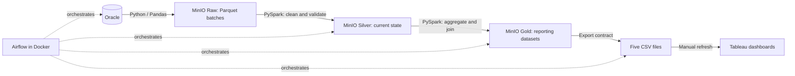

# Sanlam Insurance Data Pipeline

An end-to-end insurance analytics project built during an introductory internship at Sanlam Maroc. It connects a synthetic Oracle source to Tableau through a layered MinIO data lake, PySpark transformations, and an Airflow workflow running in Docker.

**Oracle · Python · Pandas · Parquet · MinIO · PySpark · Airflow · Docker · Tableau**

The project uses generated insurance records. Dashboard amounts, risk scores, and fraud flags are demonstration data; they do not describe Sanlam's customers or financial results. This repository documents a local portfolio prototype.

## Architecture



Oracle and Tableau run outside the Airflow stack. MinIO runs as a separate container. PostgreSQL stores Airflow metadata, and Redis supports its Celery executor. Spark uses Hadoop's S3A connector to access MinIO; the project does not deploy AWS or a separate Hadoop cluster.

## What it demonstrates

- A relational insurance model with nine business tables and per-table ingestion watermarks.
- Incremental extraction of new and updated records, with Raw upload completed before the Oracle watermark is committed.
- Reconstruction of Silver from Raw history, with latest-record deduplication, type conversion, key checks, relationship checks, and business rules.
- Five Gold datasets with explicit grains and aggregation before joins to avoid double counting.
- Stable CSV column contracts for Tableau.
- A 13-task Airflow DAG: synthetic source changes, nine independent ingestions, Silver, Gold, and export. It runs every four days, with one retry and no overlapping DAG runs.
- Four saved Tableau dashboards covering customers, policies, claims, and premiums.

## Analytical outputs

| Dataset | One row per | Purpose |
|---|---|---|
| `customer_360` | Customer | Portfolio, segments, policies, claims, and paid claim totals |
| `policy_performance` | Policy | Product, agent, coverage, premium, and claims performance |
| `claims_performance` | Claim | Claim status and amounts, business context, and payments |
| `premium_collection` | Due month | Premium statuses, amounts, and collection rates |
| `policy_status_history` | Status-change event | Policy lifecycle and lapse/cancellation analysis |

Five Gold datasets feed the reporting interface; the workbook contains four dashboards. Policy status history is an additional export.

## Repository

```text
src/                    Oracle access, synthetic generator, ingestion, Spark jobs
airflow/                DAG, Docker image, Compose stack, container dependencies
notebooks/              Four original development notebooks, with outputs cleared
sql/SANLAM.sql          ETL_METADATA initialization and inspection SQL
docs/PROJECT_CONTRACT.md Architecture, data contracts, setup, and operational limits
output/pdf/             One retained final internship report
dashboard.twb           Tableau workbook definition
.env.example            Configuration template without real credentials
requirements.txt        Host Python dependencies
```

## Getting started

Follow the [project contract](docs/PROJECT_CONTRACT.md#setup) for the complete startup sequence, including Oracle schema creation, watermark initialization, MinIO credentials and bucket creation, and Airflow secrets.

Once those prerequisites are ready, run from the repository root:

```powershell
Set-Location airflow
docker compose --env-file ../.env up -d --build
docker compose --env-file ../.env ps
```

Open Airflow at `http://localhost:8080`, check DAG imports, and trigger `sanlam_insurance_incremental_pipeline` once. Successful execution creates the CSVs in `tableau_exports/`. Reconnect the Tableau sources to those files and refresh them manually.

The Airflow execution path in `src/pipeline_jobs.py` is the reference implementation. The notebooks preserve development work and have known differences in dependency compatibility and export behavior; see the contract before running them.

## Report

Read the [final English internship report](output/pdf/sanlam_project_report_25_26.pdf) for the project background, design, historical execution screenshots, dashboards, and conclusions. It describes both broader architectural concepts and the smaller system actually implemented here.

## Scope and limitations

Ingestion is incremental; Silver and Gold are rebuilt. Timestamp watermarks do not capture deletes or guarantee recovery of late commits. Upload-before-watermark ordering provides retry protection, rather than a distributed transaction. Output publication is sequential, and ingestion/CSV export are memory-bound at demonstration scale.

The Tableau workbook is a saved development artifact with local extract paths and older `_fresh` CSV references. It needs reconnection and refresh on another machine. CSV regeneration is automated; Tableau Desktop refresh is manual.

This publication was checked for Python/notebook syntax, export schema consistency, workbook structure, and accidental secret inclusion. It is not a new end-to-end execution against Oracle, MinIO, Airflow, and Tableau. Detailed findings and recovery boundaries are in the [project contract](docs/PROJECT_CONTRACT.md).

## Publication policy

Git tracks only the selected deliverables. Environment files, generated CSVs, Airflow logs/configuration, virtual environments, temporary files, Tableau recovery files, internal handoff/history documents, report sources, supporting research assets, and older PDFs stay local. The only published file under `docs/` is `PROJECT_CONTRACT.md`; the only published file under `output/` is the report linked above.

Third-party names, logos, and report illustrations retain their respective ownership. This repository presents student work and does not imply company endorsement.
